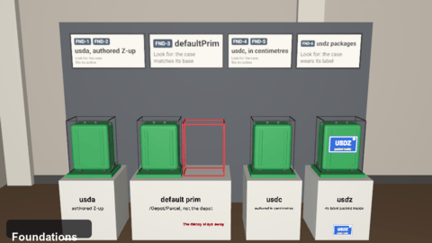

# usd-museum



**Take the tour:** open `tour.usda` with the camera `/museum/cameras/tour_cam` and press Play. One animated
camera walks every wing and stops at each exhibit (11,839 frames, about 8 minutes at 24 fps). Its path is
time-sampled data, in [tour_cam.usdc](tour_cam.usdc). In a browser:
[andrew.beer/s/usdview](https://andrew.beer/s/usdview/), then Start Museum Tour. See [Viewing](#viewing).

## What

A USD scene that shows USD's features, one exhibit at a time, so you can see whether a viewer or
runtime gets them right.

## Why

USD's behavior is defined mostly by what OpenUSD does. AOUSD is writing it down as a specification,
and the museum is a test you can look at, in support of that work. Each rule gets a small scene where
the right answer is visible: every piece sits beside a reference mark (an outline the object must
fill, a base in the color that must win, a red outline that must stay empty). When a viewer gets the
rule wrong, you see it, and the exhibit tells you which rule.

Ways to use it:

- **Check your viewer, renderer or runtime.** Play the tour, or open one exhibit. Anything that
  doesn't match its reference is a bug, and the sign beside it names the feature.
- **Recognize a bug by how it looks.** 436 forgeries each plant one plausible mistake in an exhibit
  (`composition/arcs/variants/forgeries/nofallback.usda` ignores variant fallbacks;
  `foundations/paths/names/forgeries/target_off_by_one.usda` resolves a relative path one level off).
  If your output looks like a forgery, you know which rule you're breaking.
- **Learn USD one feature at a time.** 152 features across eleven wings, each tagged on the signs
  and listed under [Features](#features) with the exhibits that show it.
- **Borrow exhibits as test fixtures.** Every exhibit is a self-contained folder with relative paths
  that opens on its own, and everything is CC0.

## Glossary

| Word | Means |
|---|---|
| **Museum** | The whole thing: `museum.usda`, every wing placed along one route, joined by corridors |
| **Wing** | One big area of USD (Composition, Animation, Materials...). A folder here, with its own `tour.usda` |
| **Hall** | A wing's entrance room: its walls and signs |
| **Gallery** | One topic inside a wing (in Composition: arcs, strength, edits...). A subfolder of the wing |
| **Exhibit** | One USD asset that demonstrates a topic. It opens on its own: `<wing>/<gallery>/<exhibit>/<exhibit>.usda` |
| **Piece** | One part of an exhibit that shows one rule (in the variants exhibit: default, stronger, fallback, nested) |
| **Reference** | The marks beside a piece that say what must happen: an outline the object must fill, a base in the color that must win, a red outline that must stay empty |
| **Forgery** | A copy of an exhibit with one plausible mistake planted. A small override layer in the exhibit's `forgeries/` folder; it renders visibly wrong against the reference |
| **Hold** | The moment in the tour when the camera pauses on an exhibit, which is when a forgery shows |
| **Tour** | `tour.usda`: a camera path through the museum or a wing, with a frame range and the museum's light |
| **Feature** | Something USD does that a user would name ("payloads", "variant fallbacks"); see below |

## Features

<!-- features: begin -->

The museum shows 152 features of USD, by wing in tour order; the 26 it doesn't show are at the end (those usdview can't show, then those not in the museum yet). Each row starts with the feature's tag, the pill on the signs in the museum (`FND-1`: the foundations wing, its first feature), then says what the feature does and the wings and galleries (`wing/gallery`) where you see it.

### 1. Foundations wing

| Tag | Feature | What it does | Where |
|---|---|---|---|
| `FND‑1` | usda text layers | A .usda file is a layer written as readable text: the same scene description as any other format. | foundations/files |
| `FND‑2` | upAxis | Root-layer metadata declaring whether Y or Z is up for all geometry on the stage. | foundations/files |
| `FND‑3` | defaultPrim | Layer metadata naming the prim that a reference or payload to the layer gets when it gives no prim path. | foundations/files |
| `FND‑4` | usdc crate files | A .usdc file is a layer in the compact binary crate format: the same scene, faster to read. | foundations/files, foundations/types |
| `FND‑5` | metersPerUnit (linear units) | Root-layer metadata giving the length of one scene unit in meters (fallback 0.01, centimeters). | foundations/files, foundations/packages |
| `FND‑6` | usdz packages | A read-only, uncompressed, 64-byte-aligned zip archive whose first file is the default layer, holding USD layers plus textures and other assets. | foundations/files, foundations/packages |
| `FND‑7` | Package-relative asset paths | Paths like pkg.usdz[inner/file.usd] address files inside a package, and relative paths authored inside a package resolve inside it. | foundations/files, foundations/packages |
| `FND‑8` | Crate versions | Each crate file says its version (0.8 to 0.13), and each version adds what it can store: layer offsets, timecodes, path expressions, relocates, splines. | foundations/files |
| `FND‑9` | Time-valued attributes (timecode and duration) | timecode values are points in time and duration values are lengths of time; when a layer is offset or scaled, timecodes are offset and scaled while durations are only scaled. | foundations/files |
| `FND‑10` | usda grammar | The text format's grammar: comments, @@@ asset paths, string escapes, exponent numbers and the legacy add list op. | foundations/files |
| `FND‑11` | usdz for AR: anchoring, preliminary schemas and the web/AR-compliant profile | Apple's Preliminary_ schemas (AnchoringAPI, physics, behaviors, text) ride along as API schemas USD doesn't know, and usdchecker --arkit / usdzip --arkitAsset enforce a restricted profile: self-contained package, allowed file types, UsdPreviewSurface only, no nested gprims. | foundations/packages |
| `FND‑12` | Asset paths and anchoring | Asset-valued fields (@path@) that are relative are resolved against the layer where they were authored, not the stage root or working directory. | foundations/packages |
| `FND‑13` | Packaging, localizing and dependency discovery | Finding every file a stage depends on and copying it into a self-contained folder or usdz with asset paths rewritten. | foundations/packages |
| `FND‑14` | Attribute value types (scalars, vectors, matrices, quaternions, strings, tokens, asset paths, arrays) | Every attribute has exactly one declared value type from a fixed list (bool, int/int64/uint/uint64/uchar, half/float/double, 2-4 vectors, 2-4 matrices, quaternions, string, token, asset, and arrays of all of them), and values must read back exactly as written in both text and binary files. | foundations/types, animation/keys |
| `FND‑15` | Value roles (point, normal, vector, color, texCoord, frame) | A role name such as color3f or point3f is the same numbers as float3 but tells tools how to interpret them (transform as a position, a normal, a direction, a linear color, a UV). | foundations/types |
| `FND‑16` | Specifiers: def, over and class | Each prim spec says whether it defines a prim (def), only overrides one if it exists (over), or is an abstract template for inheriting (class); the composed prim takes the strongest def or class, and an over never changes it. | foundations/model, composition/arcs, stage/population |
| `FND‑17` | Default traversal and prim flags | A normal walk of the stage visits only prims that are active, loaded, defined and not abstract; other walks can ask for inactive, unloaded, undefined or class prims explicitly. | foundations/model, stage/population |
| `FND‑18` | Attribute variability (uniform vs varying) | 'uniform' marks an attribute as not meant to change over time, but it is only a statement of intent: the core still reads and resolves its time samples. | foundations/model |
| `FND‑19` | Expression variables and variable expressions | Root/session layers define expressionVariables; backquoted expressions in asset paths (sublayers, references, payloads, asset values) and variant selections are evaluated from them. | foundations/model |
| `FND‑20` | Dictionary merging | Dictionaries (expressionVariables, clips, customData) merge key by key across layers: a stronger layer's key wins, a weaker layer's other keys survive. | foundations/model |
| `FND‑21` | Dictionary values and keys | A dictionary holds typed values (bool, int64, string, double2 pairs) under keys, quoted or not, and the empty string is a key too. | foundations/model |
| `FND‑22` | assetInfo | assetInfo is a dictionary describing where an asset came from (identifier, name, version); it records and changes nothing. | foundations/model |
| `FND‑23` | UTF-8 names | Prim and property names can use any Unicode letters, stored as UTF-8 and compared after normalization. | foundations/paths |
| `FND‑24` | Paths: relative and namespaced | A path written relative (../../Looks/Gold, ../.inputs:tint) resolves from the prim or property that authored it; a namespaced name (paint:base) is one name, colons and all. | foundations/paths |

### 2. Composition wing

| Tag | Feature | What it does | Where |
|---|---|---|---|
| `CMP‑1` | Inherits and class prims | inherits makes a prim pick up all opinions (properties, metadata, child prims) authored on a source prim, usually an abstract 'class' prim, ranked just below local opinions. | foundations/model, composition/arcs, composition/errors |
| `CMP‑2` | Class overrides through references (implied inherits, local and global classes) | An inherit authored inside a referenced asset is also applied in every referencing layer stack, so overriding /_class_Tree (or a class nested under the model, remapped) in the shot reaches all assets that inherit it. | composition/arcs, composition/strength |
| `CMP‑3` | Specializes | specializes is like inherits, but the base's opinions are globally weakest: anything said about the specialized prim, in any layer stack, beats anything said about the base. | composition/arcs |
| `CMP‑4` | Local opinions and over/def layering | Opinions authored directly at a prim's path anywhere in the current layer stack (root, sublayers, session) beat everything brought in by arcs. | composition/arcs, composition/strength |
| `CMP‑5` | Internal references | A reference with no asset path (</Path>) copies another prim of the same layer stack, e.g. a prefab bolt reused ten times in one exported file. | composition/arcs, composition/namespace |
| `CMP‑6` | Sub-root references and payloads | An arc may target a prim below the root of the other layer (@set.usda@</Set/Chair>), bringing that prim plus the opinions its ancestors' arcs contribute to it. | foundations/files, composition/arcs |
| `CMP‑7` | List editing of composition arcs across layers | references, payloads, inherits, specializes and variantSet names are list ops: each layer can prepend, append, delete or replace entries, and the layer stack combines them strongest first. | composition/arcs, composition/strength |
| `CMP‑8` | List ops (prepend, append, delete, explicit; legacy add/reorder) | List-valued fields (relationship targets, connections, references, inherits, apiSchemas, clipSets, and int/string/token list metadata) are edited per layer with prepend, append and delete, or reset with an explicit list, and the layers' edits combine into one ordered list with no duplicates. | foundations/files, composition/arcs, composition/namespace, composition/edits |
| `CMP‑9` | Variant sets and variant selection | A variantSet packages named alternatives on a prim; the selected variant's opinions and child prims compose in, ranked below inherits and above references. | composition/arcs |
| `CMP‑10` | Arcs inside variants | A variant can author references, payloads, inherits, specializes and relocates, so switching a variant swaps whole assets in or out. | composition/arcs, composition/loading |
| `CMP‑11` | Where variant selections come from (weaker sites, classes, other variants) | USD finds each variant set's selection by searching the whole prim index strongest-first, including selections that a class, a reference, or another variant authors, re-evaluating as new arcs appear. | composition/arcs |
| `CMP‑12` | Variant fallbacks | When no selection is authored, the application or a plugin can name fallback variants per set (e.g. standin -> render); authored selections always beat fallbacks. | composition/arcs |
| `CMP‑13` | Nested variants | A variant can itself contain variant sets (and selections), so the inner choices available depend on the outer selection. | composition/arcs |
| `CMP‑14` | Payloads | A payload is a reference that can be left unloaded; when loaded it composes exactly like a reference but ranks just below references. | composition/loading |
| `CMP‑15` | Load and unload (working sets, load rules) | A stage can be opened with all, none or some payloads loaded, and prims can be loaded/unloaded later; unloading a prim unloads payloads beneath it. | composition/loading |
| `CMP‑16` | Strength ordering of arcs (LIVRPS) | When several arcs give a prim opinions, USD ranks them Local, Inherits, Variants, Relocates, References, Payloads, Specializes, and applies that ranking again inside every layer stack an arc brings in. | composition/strength, animation/clips |
| `CMP‑17` | Sublayers and layer stacks | A layer lists other layers as subLayers; the recursive, ordered result (the layer first and strongest) is a layer stack whose opinions combine by strength. | foundations/files, composition/strength, composition/errors, animation/keys, animation/time |
| `CMP‑18` | Ancestral (inherited-from-parent) arcs | Arcs authored on a prim's ancestors contribute to the prim too, and are weaker than the same kind of arc authored on the prim itself. | composition/strength |
| `CMP‑19` | References (external) | A reference composes a prim (and its whole subtree) from another layer onto a prim here, renaming it to the referencing prim's path. | composition/strength, composition/errors, animation/time |
| `CMP‑20` | Relocates | Layer-level relocates move or rename a prim that came in through an arc (source path -> target path) without editing the source asset; the old path becomes invalid ('salted earth'). | foundations/files, composition/namespace |
| `CMP‑21` | Path translation of targets across arcs | Relationship targets and attribute connections authored inside an asset are rewritten to the stage paths where things ended up after references, variants and relocates; targets that point outside what was brought in are dropped. | composition/namespace |
| `CMP‑22` | Attribute connections | An attribute can carry a list-edited set of connection paths to other attributes (typically an input to an upstream output); USD stores and translates them but computes no dataflow. | foundations/paths, composition/namespace |
| `CMP‑23` | Relationships and target path translation | A relationship is a list-edited set of paths to other prims or properties; when it comes in through a reference, payload, variant or inherit, USD rewrites the authored paths into the stage's namespace. | foundations/paths, composition/namespace |
| `CMP‑24` | Relationship forwarding | A relationship can target another relationship; asking for forwarded targets follows the chain to the final prims or properties, skipping purely forwarding relationships and stopping at cycles. | composition/namespace |
| `CMP‑25` | Array edits (sparse edits to array values) | An array-valued attribute can hold an edit instead of a whole array (write value to index, append, prepend, erase, resize, minsize/maxsize) that applies on top of the next weaker array, including per time sample and in clips. | composition/edits |
| `CMP‑26` | Diamonds (repeated arcs) | When two arcs bring in the same layer (a diamond), it is composed once, at its strongest place. | composition/errors |
| `CMP‑27` | Cycles | An arc that would bring in something it is already inside (a reference, inherit or sublayer cycle) is reported and skipped; the rest still composes. | composition/errors |
| `CMP‑28` | Composition errors and recovery | Bad arcs (missing files, missing target prims, cycles, invalid relocates or targets, conflicting property types) are reported and skipped while the rest of the stage composes. | composition/errors |
| `CMP‑29` | Relocates combined with classes, variants and payloads | A relocated prim keeps the inherits it had at its old place ('spooky inherits'), can be overridden by variants, can come from a payload, and connections pointing at it are remapped. | composition/namespace |

### 3. Instancing wing

| Tag | Feature | What it does | Where |
|---|---|---|---|
| `INS‑1` | Instanceable prims | A prim marked instanceable shares one prototype with every prim that composes the same way; overs inside an instance, or on its ancestors, are ignored, and its own arcs are kept. | instancing/native |
| `INS‑2` | Prototype sharing (which instances share a prototype) | Instances share a prototype only if they compose identically below the root (same arcs, same variant selections, same load state and mask); a different selection or an added class arc makes a new prototype. | instancing/native |
| `INS‑3` | Nested instancing and payloads inside instances | Prototypes can themselves contain instances, and instances can contain payloads; the same override restrictions apply at every level. | instancing/native |
| `INS‑4` | Point instancers and prototypes | A PointInstancer draws a copy of one of its prototypes at each point; protoIndices pick which, and the prototypes are not drawn where they stand. | instancing/points |
| `INS‑5` | Point instancer masking, ids and motion (inactiveIds, invisibleIds, velocities) | Instances can be hidden by id without editing the arrays (inactiveIds as list-edited metadata, invisibleIds as an animatable attribute), ids track particle identity over time, and velocities/accelerations give correct motion between samples. | instancing/points |
| `INS‑6` | Orientations and scales | Each instance can turn (orientations, quaternions) and stretch (scales) about its own origin. | instancing/points |
| `INS‑7` | Per-instance primvars | A primvar on the instancer with one value per instance, such as a color, gives every copy its own value. | instancing/points |
| `INS‑8` | Skinned instances | Instanced skinned characters share one prototype, yet each can play its own animation (skel:animationSource) and carry its own primvars. | instancing/crowds |

### 4. Animation wing

| Tag | Feature | What it does | Where |
|---|---|---|---|
| `ANI‑1` | Interpolation of time samples (linear, held) and extrapolation | Between two keys USD blends linearly when the type allows it (component-wise for vectors and matrices, slerp for quaternions, element-wise for equal-length arrays) and otherwise holds the earlier key; before the first and after the last key it holds. | animation/keys |
| `ANI‑2` | Default values vs time samples (value resolution order) | An attribute can hold a timeless default and time samples at once; at a frame the strongest layer that has any value wins, and within that layer time samples (then splines) beat the default; asking with no time reads only the default. | animation/keys, stage/imageable, physics/motion |
| `ANI‑3` | Layer offsets (time offset and scale) | A sublayer, reference or payload can carry (offset, scale) that remaps the time of everything it brings in; offsets compose down the chain. | foundations/files, animation/time, animation/characters |
| `ANI‑4` | Layer-offset timing of values (offset, scale, frame-rate scaling) | When a sublayer or reference carries an offset and scale, or a different timeCodesPerSecond, every time sample, spline knot and clip time it brings in is remapped to stage time. | animation/time |
| `ANI‑5` | timeCodesPerSecond and framesPerSecond | Layer metadata that maps timecodes to real seconds; layers at a different rate are automatically stretched to the stage's rate when composed. | animation/time, physics/motion |
| `ANI‑6` | Splines (Ts animation curves) | An attribute can hold a spline of knots (time, value, tangents, per-segment interpolation: held, linear, curve; Bezier or Hermite), evaluated to a scalar value at any time. | foundations/files, animation/splines |
| `ANI‑7` | Spline extrapolation and looping | Before the first and after the last knot a spline can be held, linear, sloped, or loop (repeat, reset, oscillate); 'inner loops' repeat a section in the middle (deprecated in 26.11). | animation/splines |
| `ANI‑8` | Value clips (sequenced animation from many files) | 'clips' metadata on a prim pulls time samples for its attributes from a list of clip layers, each active over a stage-time range, as if the samples were authored in place. | foundations/model, animation/clips |
| `ANI‑9` | Clip timing (times mapping, jumps, reversal, offsets) | The clip 'times' list maps stage time to time inside the clip, piecewise linearly, which allows holds, loops, reversal and jumps; layer offsets above the clips shift and scale the whole mapping. | animation/clips |
| `ANI‑10` | Clip manifests and missing values in clips | A clip manifest lists which attributes the clips animate; when an active clip has no samples for one of them, USD uses the manifest's default or block, or, if asked (interpolateMissingClipValues), interpolates from neighbouring clips. | animation/clips |
| `ANI‑11` | Clip sets, template clips and clipSets ordering | A prim can have several named clip sets (each its own dictionary inside 'clips'), ordered by the list-edited 'clipSets' metadata; a set can also name its clips with a template path like 'sim.###.usd' and a start, end and stride. | animation/clips |
| `ANI‑12` | Attribute blocks (None default) | Writing 'attr = None' in a stronger layer hides every weaker default and animation for that attribute, so it reads as having no authored value (the schema fallback, if any, shows through). | animation/blocks |
| `ANI‑13` | Value blocks inside animation (blocked time samples and spline segments) | A None at one time sample (or a spline segment with no value) means 'no value from here until the next key', and unlike an attribute block the schema fallback does not show through. | animation/blocks |
| `ANI‑14` | Animation blocks | Writing 'attr = AnimationBlock' hides weaker time samples and splines but lets a weaker default value through. | animation/blocks |
| `ANI‑15` | Skeletons and joint animation | A Skeleton lists joints as path tokens with bind and rest transforms; a SkelAnimation supplies vectorized translations, quaternion rotations and scales over time; skel:skeleton and skel:animationSource bind them under a SkelRoot. | animation/characters |
| `ANI‑16` | Skinning (joint influences, geomBindTransform, linear and dual-quaternion) | SkelBindingAPI primvars skel:jointIndices and skel:jointWeights (with elementSize) and skel:geomBindTransform tell how points follow joints, by classicLinear or dualQuaternion skinning. | instancing/crowds, animation/characters |
| `ANI‑17` | Blend shapes and inbetweens | BlendShape prims hold point offsets (optionally sparse by pointIndices, with normalOffsets) and weighted inbetween shapes; the SkelAnimation's blendShapeWeights drive them by name. | animation/characters |
| `ANI‑18` | Spatial audio, asset previews and authorship (UsdMedia) | SpatialAudio places a sound in the scene (spatial or ambient) with playback timing; AssetPreviewsAPI stores thumbnails in assetInfo; AuthorshipAPI (new in 26.11) records who authored what. | animation/characters |
| `ANI‑19` | Motion: velocities, accelerations and motion blur | Point-based prims can carry velocities and accelerations so positions can be extrapolated between samples; MotionAPI's motion:blurScale and nonlinearSampleCount control blur. | animation/motion |

### 5. Rigging wing

| Tag | Feature | What it does | Where |
|---|---|---|---|
| `RIG‑1` | OpenExec (computed values) | Controllers compute attribute values, such as a joint's transform, from other attributes, so a rig drives its parts instead of every pose being keyed. | rigging/exec |

### 6. Stage wing

| Tag | Feature | What it does | Where |
|---|---|---|---|
| `STG‑1` | Active and inactive prims (non-destructive deletion) | Setting active = false on a prim removes it and everything under it from the composed stage, reversibly, and a stronger layer can set it back to true. | stage/population |
| `STG‑2` | Kind and model hierarchy (assembly, group, component, subcomponent) | The kind metadata labels prims as assemblies, groups, components or subcomponents, and the unbroken chain of group-kinds from the root down to components forms the model hierarchy, a cheap table of contents of the scene. | stage/population, stage/imageable |
| `STG‑3` | Model draw modes (origin, bounds, cards) | model:drawMode on a model asks viewers to replace the model's subtree with a stand-in (its axes, its bounding box, or textured cards); it inherits down the model hierarchy and applies at components unless model:applyDrawMode = false. | instancing/crowds, stage/population, stage/imageable |
| `STG‑4` | Property ordering | A composed prim lists its properties in 'dictionary' order (case-insensitive, numbers compared as numbers), not as written, unless the strongest propertyOrder (reorder properties) moves some names to the front. | stage/population |
| `STG‑5` | Typed and untyped prims (schema type names) | A prim's typeName (Mesh, Xform, Sphere...) names the schema that gives it built-in properties and behaviour; a prim may have no type, or a type this build doesn't know. | foundations/model, stage/schemas |
| `STG‑6` | Fallback prim types (fallbackPrimTypes) | Root-layer metadata that says 'if you don't know type X, treat the prim as type Y', tried in order. | stage/schemas |
| `STG‑7` | Applied API schemas (single-apply) | The apiSchemas list on a prim mixes extra schemas (MaterialBindingAPI, GeomModelAPI...) into its definition, adding built-in properties and answering HasAPI. | foundations/packages, stage/schemas |
| `STG‑8` | Multiple-apply API schemas (instance names) | Some API schemas (CollectionAPI, AccessibilityAPI, physics limits) can be applied several times to one prim, each with an instance name that becomes part of its property names. | stage/schemas |
| `STG‑9` | Schema fallback values | A schema can give an attribute a value that is reported when nothing is authored (Sphere radius 1, visibility 'inherited'), without writing it to any file. | stage/schemas |
| `STG‑10` | Prim definitions: built-in property metadata and metadata fallbacks | For built-in properties, the schema decides metadata such as variability and allowed tokens, and unauthored prim metadata (active, kind, instanceable) has a defined 'not set' meaning. | stage/schemas |
| `STG‑11` | Collections (includes, excludes, expansion rules) | CollectionAPI:name on a prim defines a named set of prims and properties by including paths, excluding sub-paths, and an expansion rule (explicitOnly, expandPrims, expandPrimsAndProperties); collections can include other collections. | stage/collections |
| `STG‑12` | Visibility and its inheritance | visibility = invisible hides an imageable prim and its whole subtree (pruning); inherited (the fallback) means 'whatever my parent is'; it can be animated. | animation/keys, stage/imageable |
| `STG‑13` | Purpose (default, render, proxy, guide) | Purpose tags imageable subtrees as always drawn (default), final-render only (render), fast-preview only (proxy) or interactive helpers (guide); an imageable prim's authored purpose wins, otherwise it inherits the nearest imageable ancestor's authored purpose. | stage/imageable |
| `STG‑14` | Extent on boundable prims | extent stores a gprim's local-space bounding box (min, max) for the values authored, so readers don't have to read all the points to bound it. | stage/imageable |
| `STG‑15` | Computed bounds and model extentsHint | World and local bounds of any subtree are computed from leaf extents and transforms for a chosen set of purposes, skipping invisible prims; models may cache their bounds per purpose in extentsHint. | stage/imageable |

### 7. Geometry wing

| Tag | Feature | What it does | Where |
|---|---|---|---|
| `GEO‑1` | Implicit primitives (Sphere, Cube, Cone, Cylinder, Capsule, Plane and the _1 variants) | Analytic shapes defined by a few numbers (radius, height, size, axis) instead of a point list. | geometry/shapes |
| `GEO‑2` | Holes | holeIndices name faces a mesh keeps in its topology but does not draw. | geometry/meshes |
| `GEO‑3` | Normals | Authored normals shade a mesh smooth or sharp; a mesh with no normals and no subdivision draws faceted. | geometry/meshes |
| `GEO‑4` | Double-sided | doubleSided draws a surface from behind as well as from the front; a single-sided surface's back may be culled. | geometry/meshes |
| `GEO‑5` | Winding order | orientation (rightHanded or leftHanded) says which way each face's vertices wind, and so which side is its front. | geometry/meshes |
| `GEO‑6` | Faces of any shape | faceVertexCounts and faceVertexIndices build faces with any number of corners, concave ones too, from one shared point list. | geometry/meshes |
| `GEO‑7` | Subdivision schemes | subdivisionScheme says how a renderer smooths a mesh: catmullClark, loop (triangles), bilinear, or none (drawn as its polygons). | geometry/meshes |
| `GEO‑8` | Creases and corners | Crease and corner sharpness keep chosen edges and vertices sharp while the rest of a subdivision surface smooths. | geometry/meshes |
| `GEO‑9` | Tetrahedral meshes | A TetMesh is a set of tetrahedra (4 indices each) plus optional surface triangles, for volumetric simulation. | geometry/meshes |
| `GEO‑10` | Curve widths | BasisCurves batch many curves into one prim; widths set how thick each is, per vertex or for the whole curve. | geometry/curves |
| `GEO‑11` | Points | A Points prim stores particles, each drawn as wide as its width. | geometry/curves |
| `GEO‑12` | Curve bases and wrap | A cubic curve follows its points by a basis (bezier, bspline, catmullRom); wrap makes it open, closed (periodic) or pinned to its end points. | geometry/curves |
| `GEO‑13` | NURBS patches | A NurbsPatch is a smooth rational B-spline surface from a grid of control points, orders and knots. | geometry/curves |
| `GEO‑14` | Hermite curves | HermiteCurves store points and tangents for interchange; a renderer need not draw them. | geometry/curves |
| `GEO‑15` | Volume fields | A Volume names its fields (density, emission) through field:<name> relationships to OpenVDBAsset prims, each a file and a grid name. | geometry/volumes |
| `GEO‑16` | Field sequences | A field's filePath can be time-sampled, so a volume plays a sequence of files. | geometry/volumes |
| `GEO‑17` | Transform ops | A prim's local transform is built from op attributes: translate, scale, rotateXYZ and the other rotation orders, orient (a quaternion), transform (a matrix). | foundations/types, geometry/xforms |
| `GEO‑18` | Op order | xformOpOrder lists the ops in the order they apply; the same ops in another order place the prim differently. | geometry/xforms |
| `GEO‑19` | Pivots (!invert! ops) | An !invert! op undoes a named op, so translate:pivot, a rotation, then !invert!translate:pivot turns a prim about a pivot point. | geometry/xforms |
| `GEO‑21` | Boundary and face-varying rules | interpolateBoundary, faceVaryingLinearInterpolation and triangleSubdivisionRule say how a subdivision surface treats its boundary, its UVs and its triangles. | geometry/meshes |

### 8. Materials wing

| Tag | Feature | What it does | Where |
|---|---|---|---|
| `MAT‑1` | UsdPreviewSurface | One small physically based surface every USD reader is expected to draw: diffuse, metallic, roughness, emission, opacity, ior and a few more inputs. | materials/surfaces |
| `MAT‑2` | MaterialX files | A .mtlx document can be referenced like a USD layer; its materials, node graphs and ND_ shaders appear as prims. | materials/surfaces |
| `MAT‑3` | File format plugins and file format arguments | Any file type with a registered SdfFileFormat (mtlx, abc, custom) can be opened, sublayered or referenced as a layer, optionally with :SDF_FORMAT_ARGS: arguments. | materials/surfaces |
| `MAT‑4` | Render contexts | A Material can carry a universal outputs:surface and renderer-specific ones such as outputs:mtlx:surface; each renderer picks its own. | materials/surfaces |
| `MAT‑5` | MaterialX nodes in USD | MaterialX shaders (ND_ nodes such as ND_standard_surface_surfaceshader) can be authored directly as USD Shader prims. | materials/surfaces |
| `MAT‑6` | Texture color spaces | A texture reader's sourceColorSpace says whether a file's values are sRGB-encoded or raw data. | materials/surfaces |
| `MAT‑7` | Color spaces of values | A color's space is its attribute's colorSpace metadata if authored, else the nearest ColorSpaceAPI up the namespace, else linear Rec.709; colorSpace:name without the API applied is ignored. | materials/surfaces, materials/color |
| `MAT‑8` | Texture coordinates (primvar readers, UsdTransform2d) | A primvar reader feeds a texture its st coordinates, and UsdTransform2d can rotate, scale and move them on the way. | materials/textures |
| `MAT‑9` | Normal maps | A texture's scale and bias turn a tangent-space normal map's 0..1 values into normals the surface shades with. | materials/textures |
| `MAT‑10` | Alpha cutouts | opacityThreshold cuts a surface where its opacity is below the threshold: a leaf, not a square. | materials/textures |
| `MAT‑11` | Texture files | UsdUVTexture reads 8- and 16-bit PNGs and half-float EXRs as the same picture. | materials/textures |
| `MAT‑12` | UDIM tiles | A texture path with <UDIM> reads one file per unit square of uv: 1001, 1002 and on. | materials/textures |
| `MAT‑13` | Direct and inherited binding | material:binding on a prim binds its material to it and everything below it; a deeper binding wins. | foundations/paths, stage/schemas, materials/binding |
| `MAT‑14` | Binding strength | An ancestor's binding marked strongerThanDescendants beats the bindings below it. | materials/binding |
| `MAT‑15` | Material purpose | material:binding:preview and material:binding:full bind different materials for preview and final renders; the purpose's own binding beats the all-purpose one. | materials/binding |
| `MAT‑16` | Collection-based material binding | material:binding:collection:<name> targets a collection and a material, so one relationship assigns a look to many prims. | stage/population, stage/schemas, stage/collections, materials/binding |
| `MAT‑17` | Geometry subsets and families (incl. per-face materials) | GeomSubset child prims name sets of faces, points, edges, segments or tetrahedra of their parent; familyName and familyType group them, and the materialBind family gives per-face materials. | geometry/meshes, materials/binding |
| `MAT‑18` | Primvars and interpolation modes | A primvar is an attribute in the primvars: namespace whose array is spread over the surface by its interpolation: constant (one value), uniform (per face), varying and vertex (per point), faceVarying (per face corner), with elementSize values per element. | stage/schemas, materials/primvars |
| `MAT‑19` | Indexed primvars | A primvar can store unique values once plus an int[] primvars:name:indices array saying which value each element uses; flattening expands it. | materials/primvars |
| `MAT‑20` | Primvar inheritance down namespace | Constant-interpolation primvars authored on an ancestor apply to every imageable descendant that doesn't author its own value. | materials/primvars |
| `MAT‑21` | Materials, shaders, node graphs, connections and interface inputs | Shading networks are prims (Material, NodeGraph, Shader) whose inputs and outputs connect, with public interface inputs on containers that drive inner nodes. | materials/surfaces |
| `MAT‑22` | Shader sources (sourceAsset, sourceCode) | A Shader can name what it is by a source file or inline code per source type, instead of a registry id. | materials/surfaces |

### 9. Lights wing

| Tag | Feature | What it does | Where |
|---|---|---|---|
| `LIT‑1` | Color temperature | A light's color can be set as a blackbody temperature in kelvin (enableColorTemperature, colorTemperature) instead of an RGB color. | lights/emission |
| `LIT‑2` | Exposure | A light's brightness is its intensity times 2 to the power of its exposure: +1 exposure doubles it. | lights/emission |
| `LIT‑3` | Normalize | With normalize on, a light gives the same total light whatever its size: a bigger light is dimmer per square metre. | lights/emission |
| `LIT‑4` | Shaping cones | ShapingAPI narrows a light to a cone (shaping:cone:angle, softness), so it lights a pool instead of everything around it. | lights/shaping |
| `LIT‑5` | Dome lights (environment maps, texture formats, pole axis, DomeLight_1) | A DomeLight lights the scene from an environment texture at infinity; texture:format and (on DomeLight_1) poleAxis say how the image wraps the sphere. | lights/environment |
| `LIT‑7` | Pattern-based collections (membership expressions and mode) | A collection can instead pick its members with a path expression (wildcards, //, {model} predicates, references to other collections, + - &), and the mode attribute or the automatic rule decides whether relationships or the expression are used. | stage/collections |

### 10. Cameras wing

| Tag | Feature | What it does | Where |
|---|---|---|---|
| `CAM‑1` | Focal length and aperture | A perspective camera's focal length and film aperture set how much of the scene it sees at a distance (distance x aperture / focal). | cameras/lenses |
| `CAM‑2` | Orthographic projection | An orthographic camera sees a fixed-size window with no perspective: parallel lines stay parallel, far things are not smaller. | cameras/lenses |
| `CAM‑3` | Clipping range and clipping planes | A camera draws only between its near and far clipping distances, and only on the kept side of any clipping planes. | cameras/lenses |
| `CAM‑5` | Camera exposure | A camera's exposure, ISO, shutter and f-stop combine into one brightness scale for what it records. | cameras/render |
| `CAM‑6` | Render settings | RenderSettings say which camera renders, at what resolution and aspect, and how the picture fits the camera's aperture. | cameras/render |
| `CAM‑7` | Render passes | A RenderPass renders a variant of the settings, for example with a collection of prims pruned out. | cameras/render |

### 11. Physics wing

| Tag | Feature | What it does | Where |
|---|---|---|---|
| `PHY‑1` | Colliders | CollisionAPI marks the shapes a body collides with; here each collider is a guide-purpose copy of its body, so it shows only when guides are on. | physics/motion |
| `PHY‑2` | Physics materials | Friction, restitution and density come from a physics material, bound with the physics purpose so it never changes how things look. | physics/motion |

### Not shown: usdview can't show them

10 features usdview can't show working: they need another renderer, a physics engine or a pipeline step, so the museum leaves them out.

- `LIT-6` **Light linking, shadow linking, light filters and filter linking**: Storm lights every prim, linked or not. Embree's delegate also ignores light linking; RenderMan (hdPrman) supports light and shadow linking.
- **Geometry and volume lights (MeshLightAPI, VolumeLightAPI, materialSyncMode)**: Storm and Embree emit no light from a mesh or volume; RenderMan (hdPrman) has mesh lights.
- `GEO-22` **NURBS curves**: Storm draws straight lines between the control points, not the curve; a renderer that takes Hydra's nurbsCurves prims could draw the true curve (untested).
- `GEO-23` **Particle fields (Gaussian splats)**: Storm draws nothing for a particle field (UsdVol's adapter publishes it for renderers that support Gaussian splats; untested in RenderMan).
- `CAM-4` **Focus distance and f-stop**: Storm and Embree draw no depth of field: every distance is equally sharp. RenderMan (hdPrman) and Karma blur from fStop and focusDistance (untested here).
- `STG-17` **Level of detail (UsdLod), new in 26.x**: Storm draws every level of detail item; picking one by distance is left to a pipeline or a renderer that reads UsdLod (none tested here).
- `STG-16` **Semantic labels (UsdSemantics)**: No viewer draws semantic labels; they are data for tools (search, training data, segmentation passes) that read UsdSemantics.
- `PHY-3` **Mass and centre of mass**: A viewer doesn't simulate: mass and centre of mass change motion only in a physics engine (Omniverse PhysX, Houdini, Isaac Sim).
- `PHY-4` **Joints, drives and articulations**: Joints, drives and articulations constrain motion only in a physics engine.
- `PHY-5` **Joint limits**: Joint limits stop motion only in a physics engine; the museum plays a baked swing.

### Not in the museum yet

16 features with no exhibit yet: Population masks; Namespace editing (move, rename, delete composed prims); Dynamic payloads (file format arguments from prim metadata); `ANI-20` startTimeCode and endTimeCode; Layer documentation, comment and customLayerData; Default resolver, search paths and resolver contexts; Session layer; Edit targets; Layer muting; Saving and exporting layers; Flattening a stage; Flattening a layer stack; Layer identity, anonymous layers and reload; `GEO-20` resetXformStack (ignore parent transforms); Prim child ordering; Asset info (assetInfo).

<!-- features: end -->

## The museum

### Files

| File | What it is |
|---|---|
| [museum.usda](museum.usda) | The museum as one assembly: ten wings, each referenced from `./<wing>/<wing>.usda` and placed and timed along one route, plus the corridors between them |
| [tour.usda](tour.usda) | The guided tour, 11,839 frames (8.2 minutes at 24 fps): sublayers `museum.usda` and adds the tour camera, cameras to jump to (below), the museum's light and the doors closed between wings |
| [tour_cam.usdc](tour_cam.usdc) | The tour camera's path, referenced by `tour.usda` (binary: one sample per frame) |

The whole tour runs with OpenExec off, so it leaves out the Rigging wing, which is its own
tour (`rigging/tour.usda`).

### What's in tour.usda

The top of the tour reads like a table of contents. Under `/museum`:

| Prim | What it holds |
|---|---|
| `cameras` | `tour_cam` first, then the cameras to jump to ([Cameras](#cameras)) |
| `lighting` | The museum's light: a warm key and a cool fill `DistantLight`, always on |
| `wings` | The ten wings in tour order, `wings/foundations` ... `wings/physics` |
| `corridors` | The corridors that join one wing to the next |

A wing's own `tour.usda` has the same shape: `/<wing>/cameras/tour_cam` and `/<wing>/lighting`.
Everything is loaded: there is no load schedule, so open the tour as usdview does by default, with
every payload loaded.

**Lighting.** The 13 lights are the key and fill, plus the Lights wing's exhibits, whose own lights are
part of what they show; only the dome exhibit's two dome lights switch on and off.

### Wings

Eleven wings, in tour order:

| # | Wing | Galleries | Exhibits | Forgeries |
|---|---|---|---|---|
| 1 | [foundations](foundations/foundations.usda) | files, packages, types, model, paths | 8 | 53 |
| 2 | [composition](composition/composition.usda) | arcs, loading, strength, namespace, edits, errors | 11 | 104 |
| 3 | [instancing](instancing/instancing.usda) | native, points, crowds | 3 | 25 |
| 4 | [animation](animation/animation.usda) | keys, time, splines, clips, blocks, characters, motion | 7 | 74 |
| 5 | [rigging](rigging/rigging.usda) | exec | 2 | 9 |
| 6 | [stage](stage/stage.usda) | population, schemas, collections, imageable | 8 | 47 |
| 7 | [geometry](geometry/geometry.usda) | shapes, meshes, curves, volumes, xforms | 8 | 40 |
| 8 | [materials](materials/materials.usda) | surfaces, textures, binding, primvars, color | 7 | 45 |
| 9 | [lights](lights/lights.usda) | emission, shaping, environment | 4 | 11 |
| 10 | [cameras](cameras/cameras.usda) | lenses, render | 4 | 21 |
| 11 | [physics](physics/physics.usda) | motion | 2 | 7 |

## How it's laid out

**Folders mirror prim paths.** The prim `/<wing>/<gallery>/<exhibit>` is the folder
`<wing>/<gallery>/<exhibit>/`: if you can see a prim in usdview, you can find its files. Each
wing has `<wing>.usda` (the wing itself, which opens on its own) and `tour.usda` (which adds the
camera, frame range and light). In the whole museum the same prims sit under `/museum/wings/<wing>/...`.

**Every asset has the same shape:**

```
<name>/
  <name>.usda      entry: small, the file everything else references
  payload.usda     the contents, behind the entry's payload
  parts/           further layers the contents compose
  textures/        images
  data/            non-USD files (e.g. VDB volumes)
  forgeries/       exhibits only: one layer per planted mistake
  thumbnail.jpg    the preview image
```

Paths are relative and stay inside the asset, so any asset folder still opens when copied
anywhere. Heavy data lives in `.usdc` (a layer over about 1 MB of text keeps its prims and moves
the values to `<name>_data.usdc`); everything else is `.usda`.

**Forgeries.** A forgery is a planted mistake: what a viewer with one specific bug would show.
`<exhibit>/forgeries/<key>.usda` sublayers the exhibit and overrides only what the bug changes;
its `doc` names the bug and what to look for. Open it next to the exhibit's entry to see the
difference. A few can't be written as overrides (relocates, for example) and are edited copies
in `forgeries/<key>/`; each says why.

**Broken on purpose.** Every entry passes `usdchecker` except four exhibits that break USD on
purpose: `composition/errors/cycles`, `animation/time/offsets`, `foundations/types/twins` and
`stage/schemas/applied`. Each declares its errors in
`customData["museum"]["expected_errors"]`, and the wings and tours that contain them inherit only
those errors.

## Viewing

Open a file in OpenUSD's usdview and press Play. Tours play through their camera. Put
`config/variantFallbacks` on the plugin path first, for the one piece that needs it (the
variants exhibit's fallback piece; global variant fallbacks come only from a plugin):

```sh
export PXR_PLUGINPATH_NAME=$PWD/config/variantFallbacks
usdview tour.usda --camera /museum/cameras/tour_cam                  # the whole museum
usdview composition/tour.usda --camera /composition/cameras/tour_cam # one wing
usdview composition/arcs/arcs/arcs.usda                           # one exhibit
usdview composition/arcs/arcs/forgeries/noinherit.usda            # the same exhibit, one planted mistake
```

The Rigging wing needs OpenExec, which usdview reads from the environment:

```sh
USDIMAGINGGL_ENGINE_ENABLE_EXEC_SCENE_INDEX=1 usdview rigging/tour.usda --camera /rigging/cameras/tour_cam
```

### Cameras

`tour.usda` also has cameras to jump to, in usdview's Camera > Select Camera. usdview lists the
first 20 by name and puts the rest under "More Cameras...", so they come in this order, all under
`/museum/cameras`:

1. `tour_cam`, the guided tour.
2. One per wing, in tour order (`Foundations_Wing` ... `Physics_Wing`): from the corner beside the
   wing's entrance, looking into its first gallery.
3. Nine highlights (`Highlight_FullSizeJar`, `Highlight_Crowd`, `Highlight_Skinning`,
   `Highlight_DrawModes`, `Highlight_Volumes`, `Highlight_PreviewSurface`, `Highlight_DomeLight`,
   `Highlight_LensRooms`, `Highlight_Machine`), at most one per wing.
4. One per exhibit, in tour order (`Stop_<Wing>_<Exhibit>`): the tour's view at that exhibit's stop.

They don't move, and each says in `customData["museum"]["frame"]` which tour frame to go to, so the
exhibit is where the tour shows it. They are invisible, so usdview draws no camera
outline for them. The Cameras wing's own exhibit cameras come after them.

## Who built it

Every prim in this museum was built by Claude Opus 5.5 (Anthropic), working in Claude Code: it designed
the exhibits and wrote the scripts that author them. Each file says so in OpenUSD's own authorship records
(`AuthorshipAPI`, new in OpenUSD 26.11) on the root prim of the museum, every wing and every exhibit;
`usdauthors -s tour.usda` lists them.

The museum, every wing and every exhibit also carry a 512 px thumbnail (`thumbnail.jpg` beside the file,
authored with `AssetPreviewsAPI`), for tools that show an asset before opening it. Rigging has none yet.

## License

[CC0 1.0](LICENSE): public domain. Use it for anything; no attribution needed.
